# How a Transformer-Based LLM Works

A progressive explanation from the simplest mental model to the full architecture, using diagrams at each level.

## Brief History

The transformer architecture was introduced in **2017** by a team at Google in the paper *"Attention Is All You Need"* (Vaswani et al.). It replaced the dominant approach at the time (recurrent neural networks / LSTMs) which processed text sequentially — one word at a time — making them slow and bad at remembering long-range context.

The transformer's key innovation was **self-attention**: a mechanism that lets the model look at all positions in a sequence simultaneously, in parallel. This made it both faster to train (GPU-friendly parallelism) and better at capturing relationships between distant words.

The timeline from there:
- **2018** — GPT-1 (OpenAI) showed that a decoder-only transformer, pre-trained on next-token prediction, could learn general language understanding
- **2018** — BERT (Google) used the encoder side for bidirectional understanding
- **2019** — GPT-2 demonstrated that scaling up (1.5B parameters) produced surprisingly coherent text generation
- **2020** — GPT-3 (175B parameters) showed that scale alone unlocks few-shot learning
- **2023–2026** — LLaMA, Mistral, Claude, GPT-4, and others pushed the architecture further with better data, training techniques, and scale — but the core transformer mechanism remains essentially unchanged from 2017

Everything in this document describes that core mechanism.

---

## Level 1 — The Simplest View

An LLM is a function: you give it text, it predicts the next word.

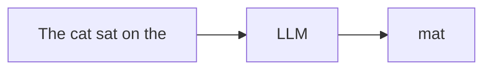

That's it. The entire complexity of a transformer exists to make this single prediction as good as possible.

---

## Level 2 — It's Actually Tokens, Not Words

Text isn't fed in as words. It's broken into **tokens** — subword chunks that the model can represent with numbers.

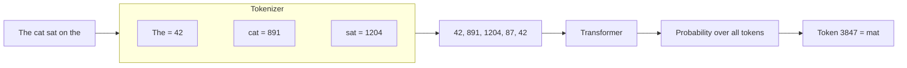

The model never sees characters or words directly — only integer IDs from a fixed vocabulary.

---

## Level 3 — Generating Multiple Tokens

The model generates text one token at a time in a loop. Each new token gets appended to the input, and the model runs again.

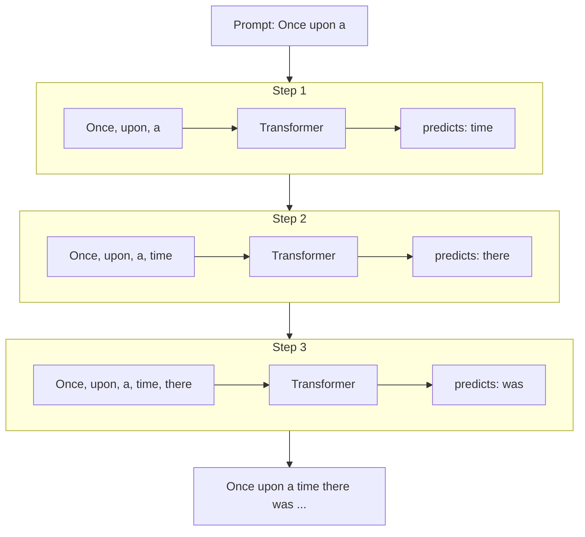

This is called **autoregressive generation** — the output feeds back as input.

---

## Level 4 — Inside the Transformer (High Level)

So the transformer takes in token IDs and outputs a prediction. But what actually happens in between? Think of it as a three-stage pipeline:

**Stage 1 — Embedding:** The model can't do math on raw integers like `42`. So the first step converts each token ID into a **vector** — a list of numbers (e.g. 256 numbers like `[0.12, -0.84, 0.37, 1.02, ...]`).

Think of it like GPS coordinates, but instead of 2 dimensions (latitude, longitude) describing where you are on Earth, the model uses 256 dimensions to describe where a token is in "meaning space." Tokens with similar meanings end up near each other in this space — for example, "cat" and "kitten" would have similar vectors, while "cat" and "democracy" would be far apart. The model *learns* these vectors during training — it discovers on its own which tokens should be close together and which should be far apart.

We also add a second vector that encodes *where* in the sequence this token sits — because "cat" in position 2 should behave differently from "cat" in position 50 (it's surrounded by different context).

In papers and code, these have standard names:
- **E** (or **W_E**) — the token embedding matrix. `E[42]` gives you the vector for token ID 42.
- **P** (or **W_P**) — the position embedding matrix. `P[3]` gives you the vector for position 3.
- **x** — the combined result: `x = E[token_id] + P[position]`. This is what flows into the transformer blocks.

As **x** passes through each block, it gets refined. You'll sometimes see it called **h** (for "hidden state") with a subscript for the layer: h₀ is the input, h₁ is after block 1, h₂ after block 2, etc.

**Stage 2 — Transformer Blocks:** This is where the magic happens. The sequence of vectors passes through N identical processing blocks, one after another. Each block does two things: (a) lets every token look at the other tokens to gather context, and (b) lets every token independently "think" and transform its representation. After N blocks, the model has built up a rich understanding of the entire sequence.

**Stage 3 — Output Head:** The final block's output vectors get converted back into predictions over the vocabulary. For each position, the model produces a score for every possible next token (e.g. 4096 scores), then normalizes those scores into probabilities.

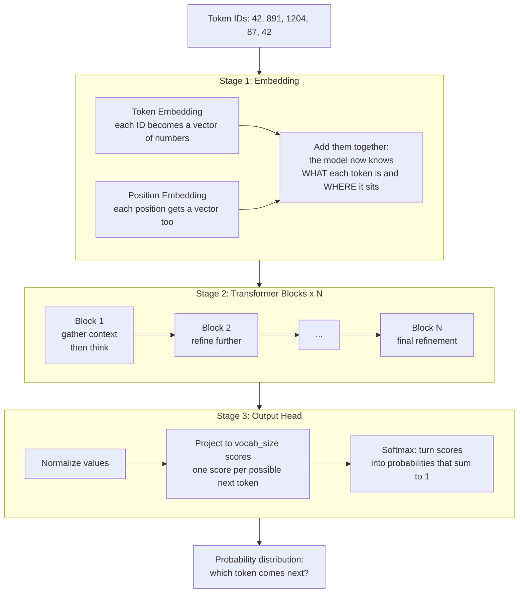

**Analogy:** Think of it like a reading comprehension pipeline. Embedding = "read each word." Transformer blocks = "re-read and think about what each word means in context, multiple times, building deeper understanding." Output head = "make your prediction based on everything you've understood."

The key insight is that *stacking more blocks* gives the model more "rounds of thinking." A 2-block model does basic pattern matching. A 12-block model can track complex grammar, references, and logic.

---

## Level 5 — What's Inside One Transformer Block?

Imagine a team meeting. First, everyone shares what they know with the group — each person listens to everyone else and picks up what's relevant to their own task (**attention**: tokens talk to each other). Then, everyone goes back to their desk and thinks privately about what they just heard, updating their own notes (**feed-forward network**: each token processes independently).

That's one transformer block: a "discuss" step followed by a "think" step. The model repeats this cycle N times — each round builds richer understanding because the discussion gets more informed with every iteration.

Two additional mechanisms keep this process stable:
- **Residual connections** — a safety net that says "even if this step is unhelpful, don't lose what you already had." Each step's output is *added* to its input rather than replacing it.
- **Normalization** — keeps the numbers from growing out of control as they pass through many layers.

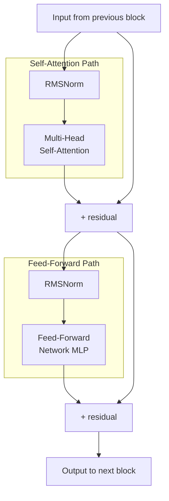

**Residual connections** (`+`) let information skip over sub-layers. Without them, gradients vanish in deep networks and the model can't learn.

**RMSNorm** keeps numbers in a stable range so training doesn't explode.

---

## Level 6 — Self-Attention: The Core Idea

Attention answers: "When predicting at this position, which other positions should I focus on?"

Each token produces three vectors:
- **Query (Q)**: "What am I looking for?"
- **Key (K)**: "What do I contain?"
- **Value (V)**: "What information should I pass along?"

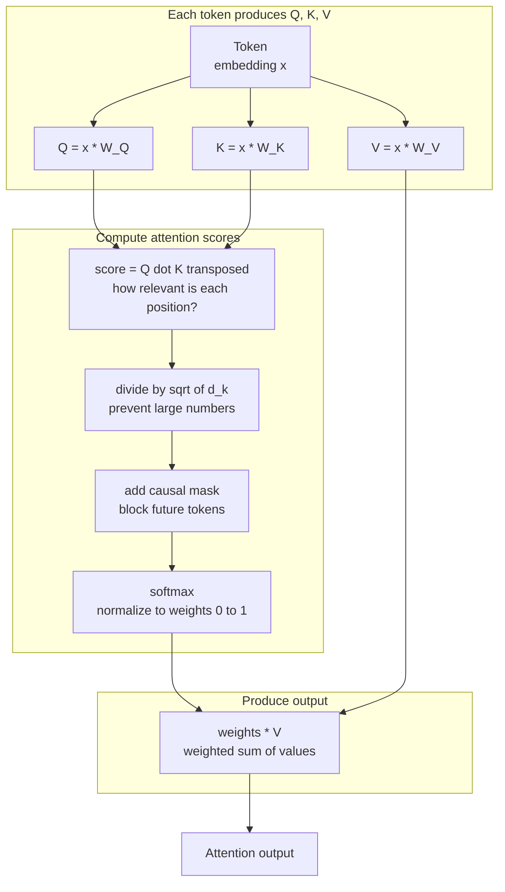

---

## Level 7 — Causal Masking (Why It Can't Cheat)

In a decoder-only model, token 3 can only attend to tokens 1, 2, 3 — never to tokens 4, 5, etc. This is enforced by the **causal mask**: a triangular matrix that blocks future positions.

```
Causal Attention Mask (who can attend to whom):

              Key position →
              Tok1  Tok2  Tok3  Tok4  Tok5
Query    Tok1 [ ✓     ✗     ✗     ✗     ✗  ]
position Tok2 [ ✓     ✓     ✗     ✗     ✗  ]
  ↓      Tok3 [ ✓     ✓     ✓     ✗     ✗  ]
         Tok4 [ ✓     ✓     ✓     ✓     ✗  ]
         Tok5 [ ✓     ✓     ✓     ✓     ✓  ]

✓ = allowed (real attention score computed)
✗ = blocked (score set to -infinity → becomes 0 after softmax)
```

The upper-right triangle is masked out. This ensures the model learns to predict the future from the past, not by peeking at it.

---

## Level 8 — Multi-Head Attention

Instead of one attention computation, we run **multiple heads in parallel** — each with its own Q, K, V projections. This lets different heads specialize in different types of relationships.

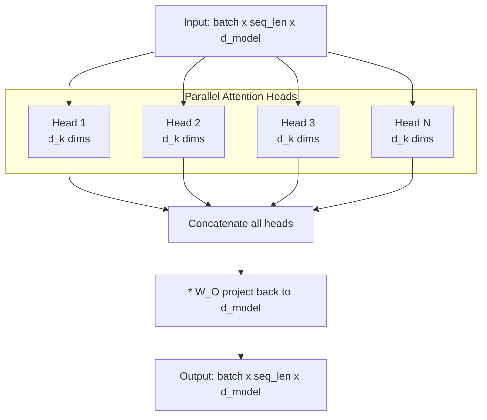

Each head operates on a slice of the full dimension: `d_k = d_model / n_heads`. After attention, results are concatenated and projected back to the full dimension.

**Why multi-head?** One head might learn "attend to the previous adjective," another might learn "attend to the verb of this clause," another might track long-range dependencies. The model decides.

---

## Level 9 — The Feed-Forward Network

After attention mixes information *between* positions, the FFN transforms each position *independently*:

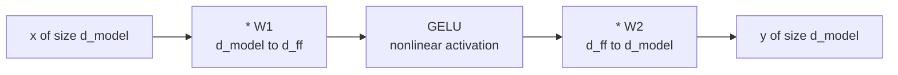

- **Expansion**: `d_ff = 4 × d_model` (e.g., 256 → 1024)
- **GELU activation**: smooth nonlinearity that lets the model learn complex patterns
- **Compression**: projects back to original dimension

Think of attention as "gather relevant context" and FFN as "process that context into useful features."

---

## Level 10 — Embeddings: Turning IDs Into Vectors

The model can't do math on integers. Embeddings convert token IDs into dense vectors the model can compute with.

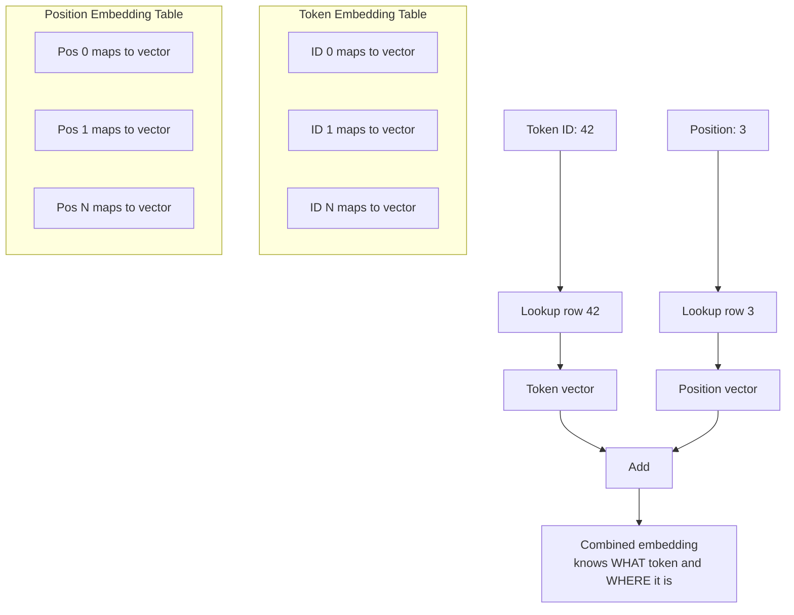

**Why positional embeddings?** Attention is permutation-invariant — without position info, "the cat sat" and "sat the cat" would look identical to the model. Position embeddings break this symmetry.

---

## Level 11 — Training: How It Learns

The model learns by predicting the next token at every position simultaneously, then adjusting weights to reduce prediction error.

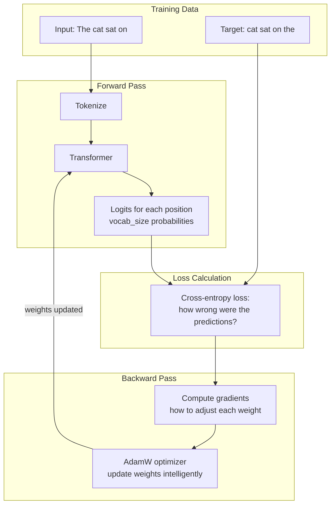

**Key insight**: the model predicts the next token at *every* position, not just the last one. For a sequence of 256 tokens, it makes 256 predictions per forward pass — this is efficient self-supervised learning.

---

## Level 12 — The Loss Function (Cross-Entropy)

The model outputs a probability distribution over the vocabulary. Cross-entropy measures how far this distribution is from the correct answer.

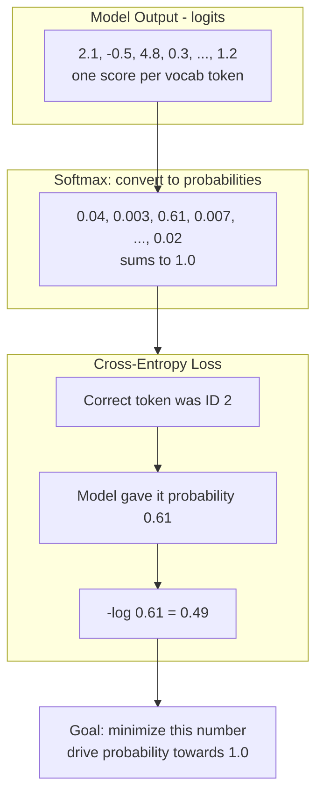

- Perfect prediction → loss = 0
- Random prediction (vocab 4096) → loss = ln(4096) ≈ 8.3
- A well-trained model → loss ≈ 2.5–3.5

---

## Level 13 — Backpropagation and the Computation Graph

Every operation in the forward pass is recorded in a graph. Backward traversal computes how much each weight contributed to the loss.

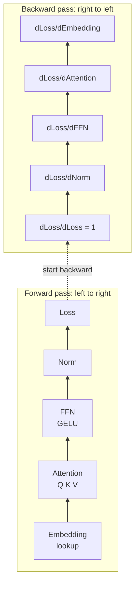

Each operation knows its local derivative (e.g., "how does my output change if my input changes?"). The **chain rule** multiplies these local derivatives together to get the gradient of the loss with respect to any weight in the network.

---

## Level 14 — The AdamW Optimizer

Gradients tell us *which direction* to move weights. The optimizer decides *how far* to move them.

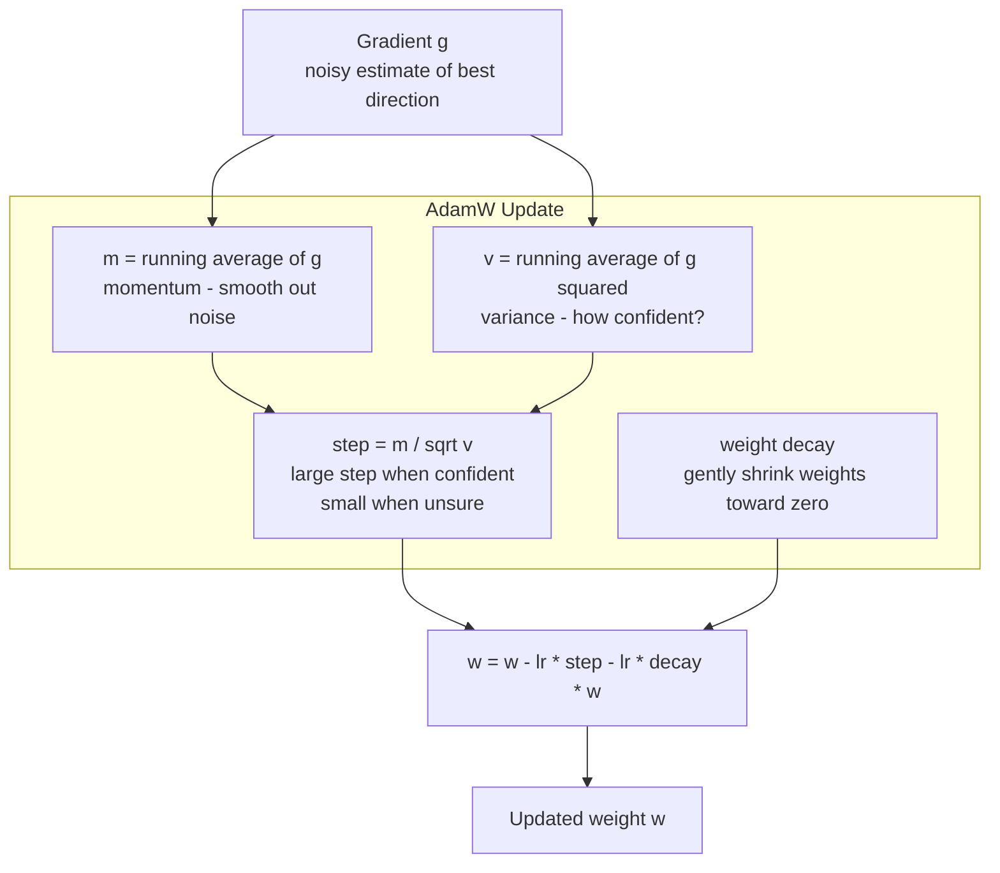

**Why not just subtract the gradient?** Raw gradients are noisy (one batch ≠ the full dataset). Adam's running averages smooth this out. The per-parameter variance scaling means frequently-updated parameters get smaller steps (already refined) while rarely-updated ones get larger steps (need more movement).

---

## Level 15 — KV Cache (Fast Inference)

During generation, we recompute the full context every time we add a token. This is O(n²) work. The KV cache eliminates redundancy.

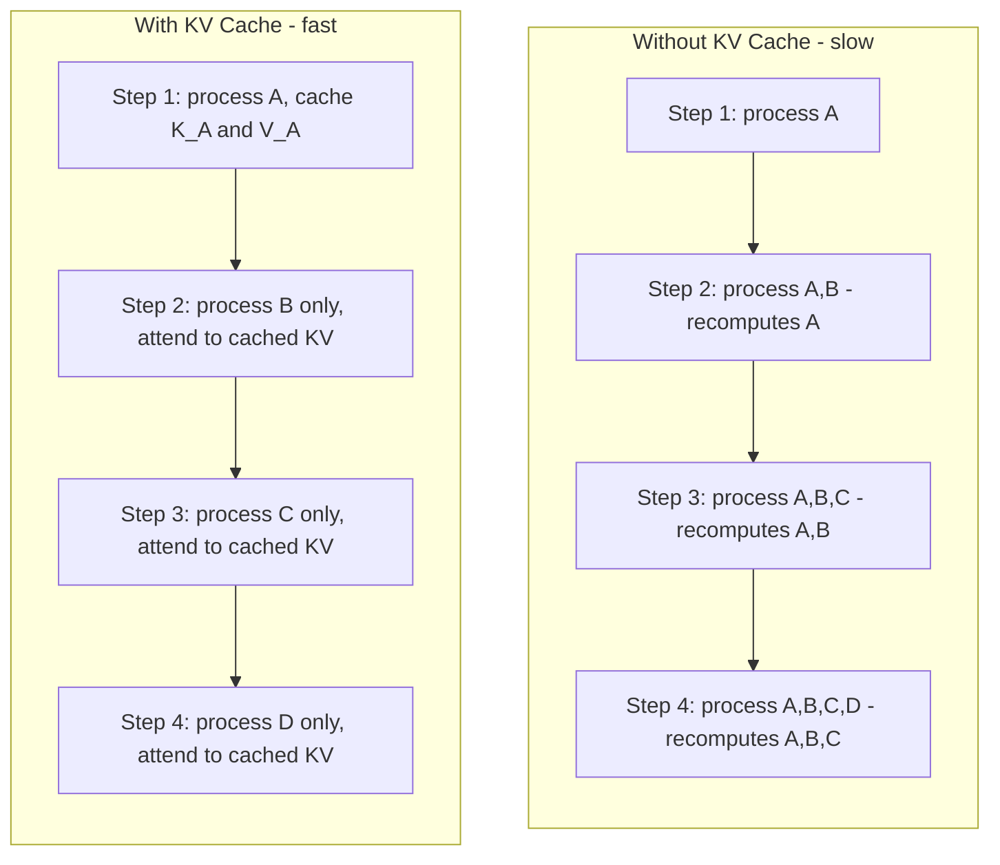

The insight: K and V vectors for past tokens never change (they only depend on that token's position and content). So we cache them and only compute Q, K, V for the new token.

---

## Level 16 — Sampling Strategies

The model outputs probabilities over the vocabulary. How we pick from that distribution controls the creativity of generation.

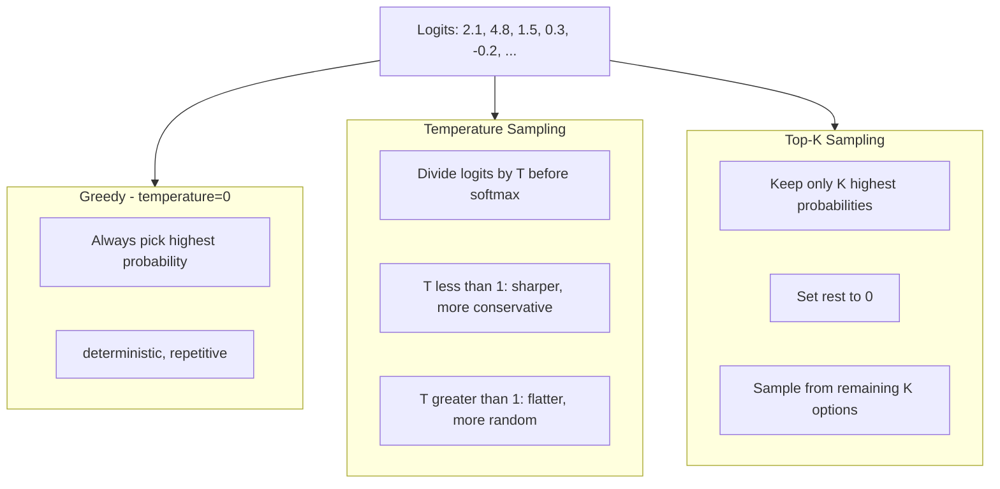

In practice, you combine temperature + top-k: scale the logits for creativity control, then restrict to top-k for safety (never pick extremely unlikely tokens).

---

## Level 17 — BPE Tokenization

Byte Pair Encoding builds a vocabulary by iteratively merging the most common adjacent pairs:

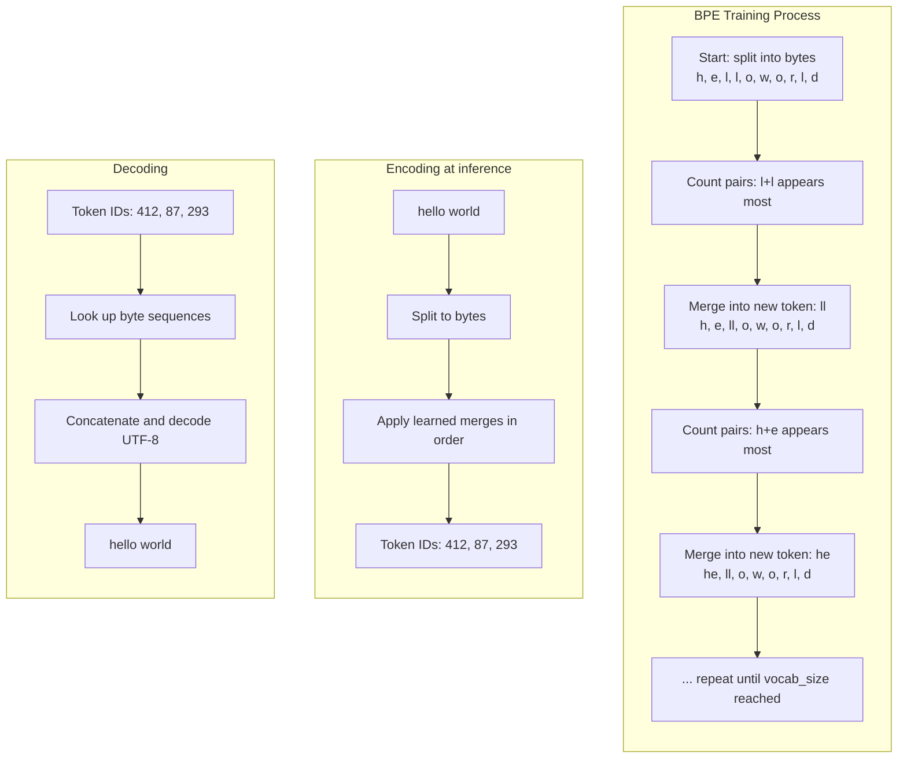

**Why BPE?** Common words become single tokens (efficient), rare words decompose into pieces (handles any input), and vocabulary size is fixed and controllable.

---

## Level 18 — Putting It All Together

The complete forward pass of a decoder-only transformer LLM:

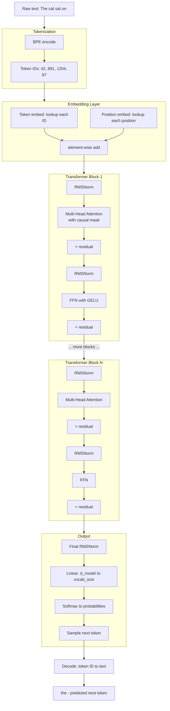

---

## Level 19 — The Training Pipeline End-to-End

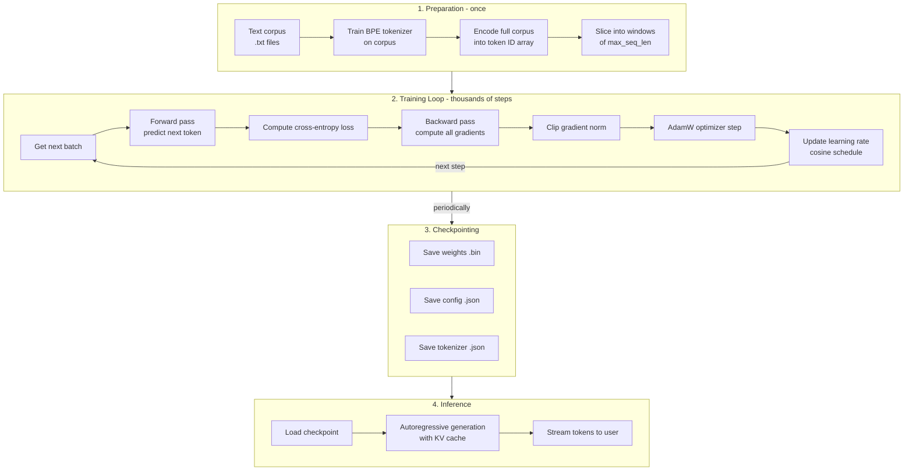

---

## Level 20 — What Makes This Work (Key Insights)

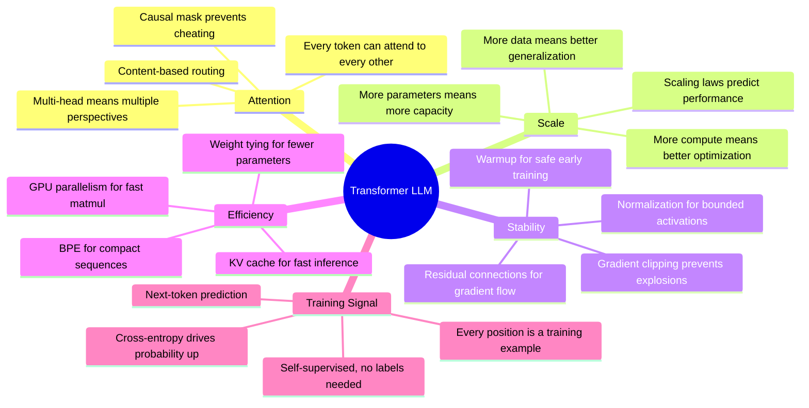

---

## Summary Table

| Layer | Purpose | Key Formula |
|-------|---------|-------------|
| BPE Tokenizer | Text → integers | Iterative pair merging |
| Token Embedding | Integer → vector | Lookup table: `embed[id]` |
| Position Embedding | Encode order | Lookup table: `pos[i]` |
| RMSNorm | Stabilize magnitudes | `x / sqrt(mean(x²) + ε) · γ` |
| Multi-Head Attention | Mix information across positions | `softmax(QKᵀ/√d + mask) · V` |
| Feed-Forward (FFN) | Transform each position independently | `GELU(xW₁)W₂` |
| Residual Connection | Preserve information + gradient flow | `x + sublayer(x)` |
| Output Head | Vectors → vocabulary scores | `x · W_vocab` |
| Cross-Entropy Loss | Measure prediction quality | `-log(p[correct])` |
| AdamW | Intelligently update weights | `θ -= lr · m̂/(√v̂+ε) + λθ` |
| KV Cache | Skip redundant computation | Cache K, V; only compute new token |

---

## What You're Building

In this project, every single row in the table above gets implemented from scratch in TypeScript — from the WGSL GPU kernels that compute the matrix multiplications, to the autograd engine that computes gradients, to the training loop that orchestrates learning, to the inference runtime that generates text token by token.

No magic. No black boxes. Just math, running on a GPU, that you wrote.
