# How a Transformer-Based LLM Works

A progressive explanation from the simplest mental model to the full architecture, using diagrams at each level.

## Brief History

The transformer architecture was introduced in **2017** by a team at Google in the paper _"Attention Is All You Need"_ (Vaswani et al.). It replaced the dominant approach at the time (recurrent neural networks / LSTMs) which processed text sequentially — one word at a time — making them slow and bad at remembering long-range context.

The transformer's key innovation was **self-attention**: a mechanism that lets the model look at all positions in a sequence simultaneously, in parallel. This made it both faster to train (GPU-friendly parallelism) and better at capturing relationships between distant words.

The timeline from there:

- **2018** — GPT-1 (OpenAI) showed that a decoder-only transformer, pre-trained on next-token prediction, could learn general language understanding
- **2018** — BERT (Google) used the encoder side for bidirectional understanding
- **2019** — GPT-2 demonstrated that scaling up (1.5B parameters) produced surprisingly coherent text generation
- **2020** — GPT-3 (175B parameters) showed that scale alone unlocks few-shot learning
- **2023–2026** — LLaMA, Mistral, Claude, GPT-4, and others pushed the architecture further with better data, training techniques, and scale — but the core transformer mechanism remains essentially unchanged from 2017

Everything in this document describes that core mechanism.

---

## Level 1 — The Simplest View

An LLM is a function: you give it text, it predicts the next word.

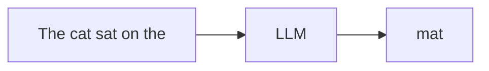

That's it. The entire complexity of a transformer exists to make this single prediction as good as possible.

---

## Level 2 — It's Actually Tokens, Not Words

Text isn't fed in as words. It's broken into **tokens** — subword chunks that the model can represent with numbers.

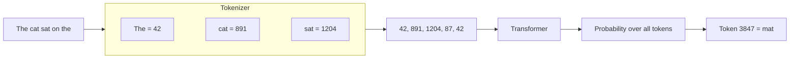

The model never sees characters or words directly — only integer IDs from a fixed vocabulary.

---

## Level 3 — Generating Multiple Tokens

The model generates text one token at a time in a loop. Each new token gets appended to the input, and the model runs again.

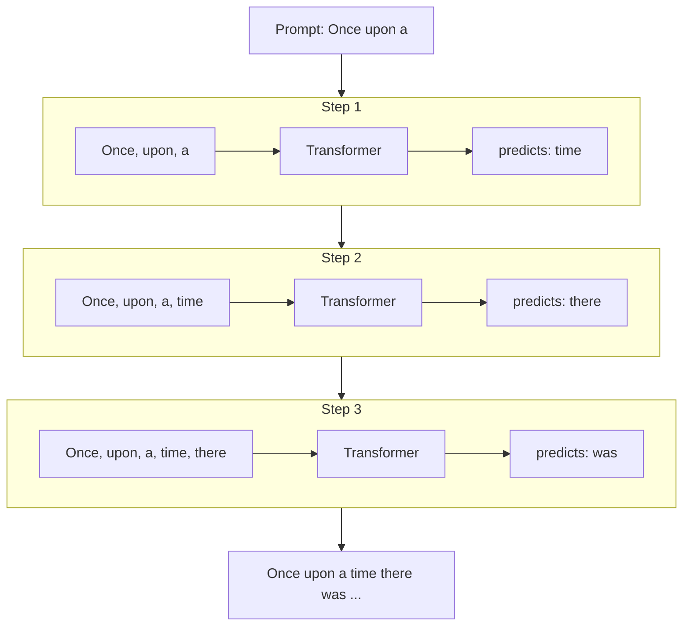

This is called **autoregressive generation** — the output feeds back as input.

---

## Level 4 — Inside the Transformer (High Level)

So the transformer takes in token IDs and outputs a prediction. But what actually happens in between? Think of it as a three-stage pipeline:

**Stage 1 — Embedding:** The model can't do math on raw integers like `42`. So the first step converts each token ID into a **vector** — a list of numbers (e.g. 256 numbers like `[0.12, -0.84, 0.37, 1.02, ...]`).

Think of it like GPS coordinates, but instead of 2 dimensions (latitude, longitude) describing where you are on Earth, the model uses 256 dimensions to describe where a token is in "meaning space." Tokens with similar meanings end up near each other in this space — for example, "cat" and "kitten" would have similar vectors, while "cat" and "democracy" would be far apart. The model _learns_ these vectors during training — it discovers on its own which tokens should be close together and which should be far apart.

> **A natural question: what does each individual dimension mean?**
>
> Honest answer: we don't know, and we don't control it. There is no rule that says "dimension 0 encodes sentiment" or "dimension 47 encodes plurality." Every dimension starts as random noise, and training nudges all 256 numbers per token to whatever values make next-token prediction work better. _If_ splitting "is this a noun" into its own dimension helps prediction, the model might learn to do that. _If_ mixing concepts across many dimensions helps more, it does that instead. The dimensions are **emergent learned features**, not pre-defined ones.
>
> Bigger models have more room to carve out distinct features: GPT-3 used d_model = 12,288, compared to your 256. That's why scale gives more expressivity — there's literally more space in the meaning vectors.

We also add a second vector that encodes _where_ in the sequence this token sits — because "cat" in position 2 should behave differently from "cat" in position 50 (it's surrounded by different context).

In papers and code, these have standard names:

- **E** (or **W_E**) — the token embedding matrix. `E[42]` gives you the vector for token ID 42.
- **P** (or **W_P**) — the position embedding matrix. `P[3]` gives you the vector for position 3.
- **x** — the combined result: `x = E[token_id] + P[position]`. This is what flows into the transformer blocks.

As **x** passes through each block, it gets refined. You'll sometimes see it called **h** (for "hidden state") with a subscript for the layer: h₀ is the input, h₁ is after block 1, h₂ after block 2, etc.

**Stage 2 — Transformer Blocks:** This is where the magic happens. The sequence of vectors passes through N identical processing blocks, one after another. Each block does two things: (a) lets every token look at the other tokens to gather context, and (b) lets every token independently "think" and transform its representation. After N blocks, the model has built up a rich understanding of the entire sequence.

**Stage 3 — Output Head:** The final block's output vectors get converted back into predictions over the vocabulary. For each position, the model produces a score for every possible next token (e.g. 4096 scores), then normalizes those scores into probabilities.

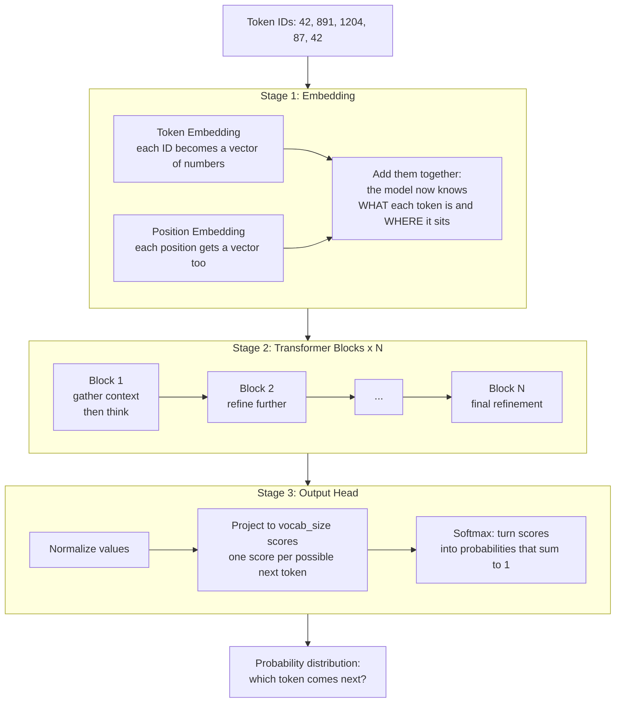

**Analogy:** Think of it like a reading comprehension pipeline. Embedding = "read each word." Transformer blocks = "re-read and think about what each word means in context, multiple times, building deeper understanding." Output head = "make your prediction based on everything you've understood."

The key insight is that _stacking more blocks_ gives the model more "rounds of thinking." A 2-block model does basic pattern matching. A 12-block model can track complex grammar, references, and logic.

---

## Level 5 — What's Inside One Transformer Block?

Imagine a team meeting. First, everyone shares what they know with the group — each person listens to everyone else and picks up what's relevant to their own task (**attention**: tokens talk to each other). Then, everyone goes back to their desk and thinks privately about what they just heard, updating their own notes (**feed-forward network**: each token processes independently).

That's one transformer block: a "discuss" step followed by a "think" step. The model repeats this cycle N times — each round builds richer understanding because the discussion gets more informed with every iteration.

Two additional mechanisms keep this process stable:

- **Residual connections** — a safety net that says "even if this step is unhelpful, don't lose what you already had." Each step's output is _added_ to its input rather than replacing it.
- **Normalization** — keeps the numbers from growing out of control as they pass through many layers.

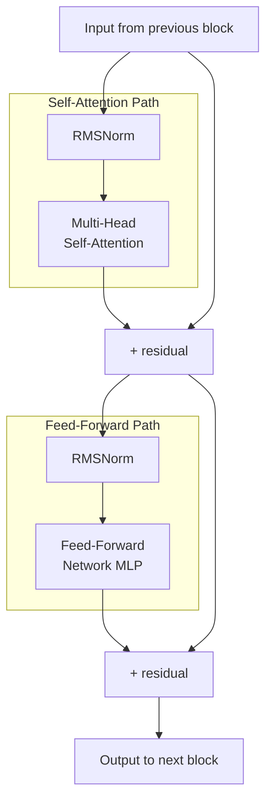

**Residual connections** (`+`) let information skip over sub-layers. Without them, gradients vanish in deep networks and the model can't learn.

**RMSNorm** keeps numbers in a stable range so training doesn't explode.

---

## Level 6 — Self-Attention: The Core Idea

Attention answers: "When predicting at this position, which other positions should I focus on?"

Each token produces three vectors:

- **Query (Q)**: "What am I looking for?"
- **Key (K)**: "What do I contain?"
- **Value (V)**: "What information should I pass along?"

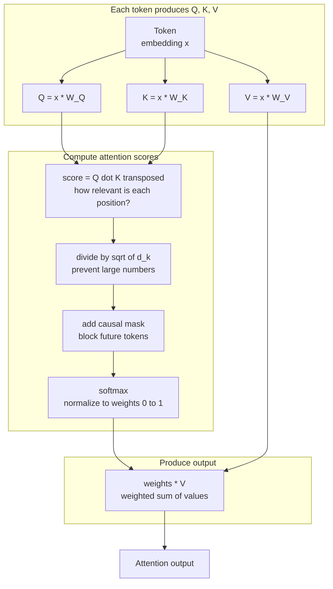

### Three clarifications that often trip people up

**1. The weights are persistent. The Q, K, V vectors are not.**

There is exactly _one_ `W_Q`, _one_ `W_K`, _one_ `W_V` per attention head, per layer. Those weight matrices are part of the model — they get trained, saved to disk, and loaded back during inference.

The Q, K, V _vectors_ that you compute by multiplying an embedding by those weights are completely different. They're temporary — computed on the fly for each token in each forward pass, used to produce the attention output, then thrown away. The next batch comes in and brand new Q, K, V vectors get computed using the same (now slightly updated) weights.

```
Persistent (trained, saved):       Temporary (recomputed every forward pass):
W_Q, W_K, W_V matrices             Q, K, V vectors for each token
shape: d_model x d_k               shape: seq_len x d_k
one per head per layer             one set per token per head per layer
```

**2. V is _not_ the token's embedding.**

It's tempting to think attention does: "find relevant tokens via Q·K, then pass along their embeddings." That's not quite right. V is the _embedding multiplied by a learned matrix `W_V`_ — a separate projection into a different space.

Why? Because we want the model to learn _what aspect_ of an attended token to pass along, not just blindly copy it. `W_V` is the knob that says "from each attended token, extract this transformed view of it."

**3. Why we need V at all (if Q·K already says where to look)**

Q·K alone gives you scores — "how relevant is each previous token?" — but scores are just numbers between 0 and 1. They tell you _who_ to listen to, not _what_ to take from them.

V is the actual content payload. You could in principle weight-and-sum the raw embeddings, but then every attention head would be forced to extract the same thing from each token. With a separate `W_V` per head, head A can pull grammatical role out of "dog" while head B pulls semantic category. **Q and K decide _who_; V decides _what_ gets transmitted.**

---

## Level 6b — What Could `W_V` Actually Learn? A Concrete Example

Imagine a trained model processes the sentence _"I have a dog. I'm going for a walk with him."_

When the model encodes "him," attention compares "him's" Q against every previous token's K. If the model has learned anything about pronouns, "him's" Q will strongly align with "dog's" K — they refer to the same entity. So the attention weight for "dog" will be high.

Now the question is: when we pull "dog's" V into the output for "him," _what does V contain_?

`W_V` is a learned 256-dimensional projection. After training on millions of pronoun-antecedent pairs, it likely learned to **amplify** features that matter for resolving a pronoun:

- grammatical gender ("dog" is more often referred to as "he/him" in informal text)
- animacy ("dog" is a living thing, not a chair)
- semantic role (the thing being walked with — the companion, not the path)

And to **suppress** features that don't matter here:

- color, breed, size
- whether it was named earlier
- exact word frequency

Nobody told the model "extract gender." It discovered that this kind of compression made next-token prediction work better, and the gradients pushed `W_V` toward extracting it. Different heads can specialize differently — one head's `W_V` might extract syntactic role, another's might track entity identity, a third might pull stylistic register.

> This is the deepest reason multi-head attention works: each head has its own **independent learned view** of "what's worth passing along when one token attends to another."

---

## Level 7 — Causal Masking (Why It Can't Cheat)

In a decoder-only model, token 3 can only attend to tokens 1, 2, 3 — never to tokens 4, 5, etc. This is enforced by the **causal mask**: a triangular matrix that blocks future positions.

```
Causal Attention Mask (who can attend to whom):

              Key position →
              Tok1  Tok2  Tok3  Tok4  Tok5
Query    Tok1 [ ✓     ✗     ✗     ✗     ✗  ]
position Tok2 [ ✓     ✓     ✗     ✗     ✗  ]
  ↓      Tok3 [ ✓     ✓     ✓     ✗     ✗  ]
         Tok4 [ ✓     ✓     ✓     ✓     ✗  ]
         Tok5 [ ✓     ✓     ✓     ✓     ✓  ]

✓ = allowed (real attention score computed)
✗ = blocked (score set to -infinity → becomes 0 after softmax)
```

The upper-right triangle is masked out. This ensures the model learns to predict the future from the past, not by peeking at it.

---

## Level 8 — Multi-Head Attention

Instead of one attention computation, we run **multiple heads in parallel** — each with its own Q, K, V projections. This lets different heads specialize in different types of relationships.

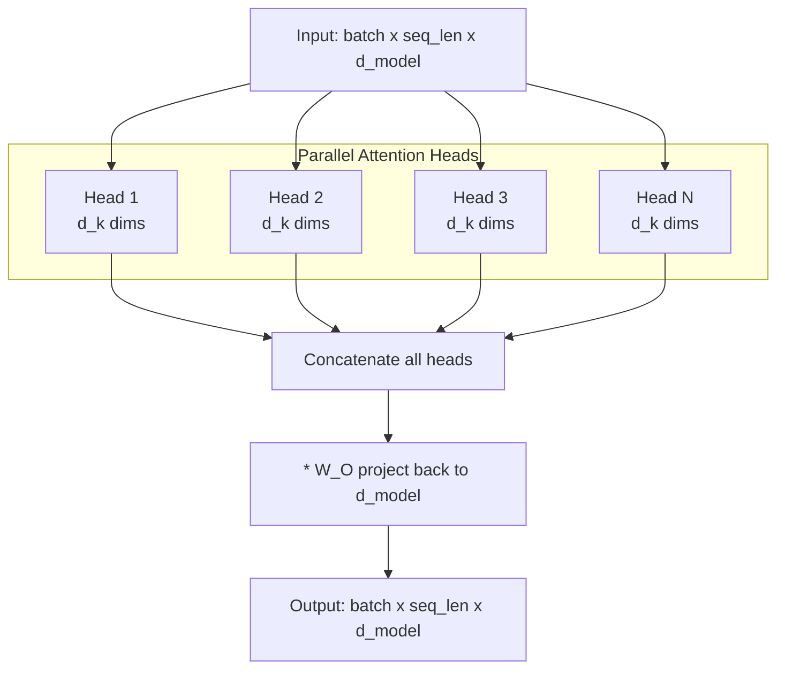

Each head operates on a slice of the full dimension: `d_k = d_model / n_heads`. After attention, results are concatenated and projected back to the full dimension.

**Why multi-head?** One head might learn "attend to the previous adjective," another might learn "attend to the verb of this clause," another might track long-range dependencies. The model decides.

---

## Level 9 — The Feed-Forward Network

After attention mixes information _between_ positions, the FFN transforms each position _independently_:

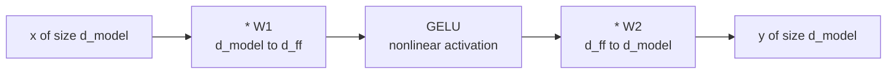

- **Expansion**: `d_ff = 4 × d_model` (e.g., 256 → 1024)
- **GELU activation**: smooth nonlinearity that lets the model learn complex patterns
- **Compression**: projects back to original dimension

Think of attention as "gather relevant context" and FFN as "process that context into useful features."

---

## Level 10 — Embeddings: Turning IDs Into Vectors

The model can't do math on integers. Embeddings convert token IDs into dense vectors the model can compute with.

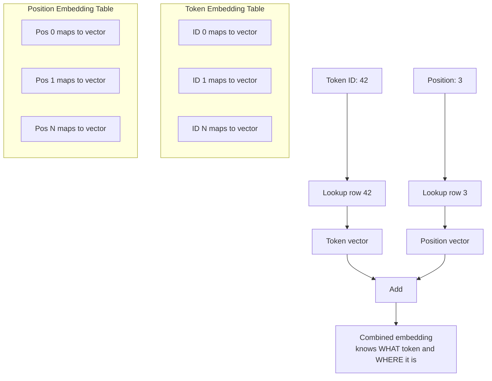

**Why positional embeddings?** Attention is permutation-invariant — without position info, "the cat sat" and "sat the cat" would look identical to the model. Position embeddings break this symmetry.

---

## Level 11 — Training: How It Learns

The model learns by predicting the next token at every position simultaneously, then adjusting weights to reduce prediction error.

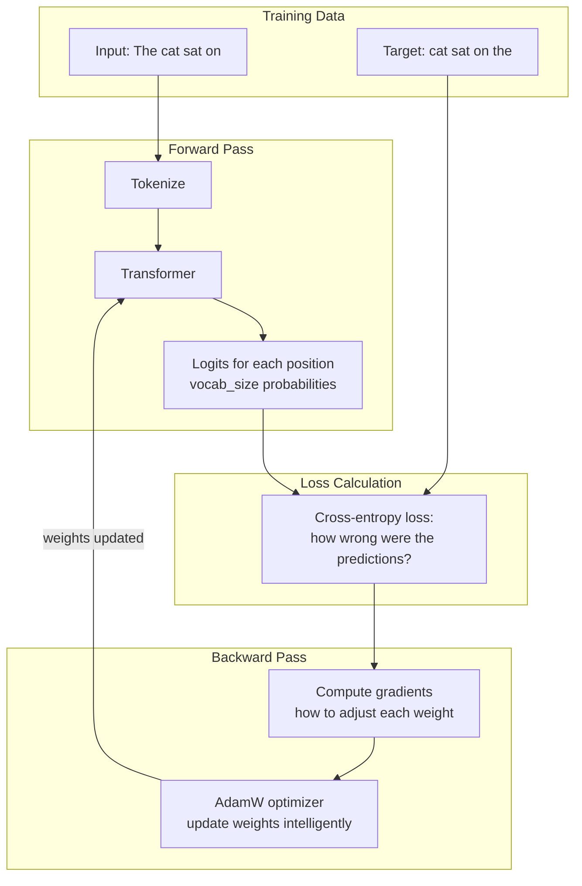

**Key insight**: the model predicts the next token at _every_ position, not just the last one. For a sequence of 256 tokens, it makes 256 predictions per forward pass — this is efficient self-supervised learning.

### How does attention learn what to focus on, with no direct label?

This is one of the deepest questions about transformers. There is no ground truth that says _"token 89 should attend to token 42 with weight 0.7."_ No human ever labels attention patterns. So how does the model end up with attention heads that track pronouns, parse sentence structure, or follow entities across paragraphs?

The answer is **indirect learning**:

1. The _only_ training signal is "predict the next token correctly."
2. Internally, the model can only do that well if it gathers useful context. Useful context lives in earlier tokens.
3. If a particular attention pattern (e.g. "this pronoun looked back at that noun") leads to better predictions, the cross-entropy loss is smaller for those positions.
4. Backprop traces that smaller loss back through softmax, through V, through Q·K, and nudges `W_Q`, `W_K`, `W_V` so that this pattern happens _more strongly_ next time.
5. Over millions of sequences, attention patterns that correlate with good predictions get reinforced. Patterns that don't, fade.

So the model is never told "pronouns should attend to nouns." It discovers that pattern because doing so helps it predict the word _after_ the pronoun. **All linguistic structure — syntax, coreference, long-range dependencies — is a side effect of optimizing one scalar loss.**

This is also why bigger models trained on more data find richer structure: there are more correlations between context patterns and next tokens for backprop to exploit.

---

## Level 12 — The Loss Function (Cross-Entropy)

The model outputs a probability distribution over the vocabulary. Cross-entropy measures how far this distribution is from the correct answer.

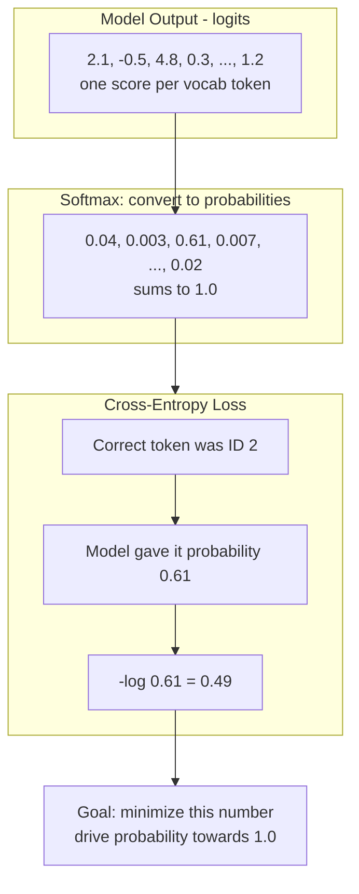

- Perfect prediction → loss = 0
- Random prediction (vocab 4096) → loss = ln(4096) ≈ 8.3
- A well-trained model → loss ≈ 2.5–3.5

---

## Level 13 — Backpropagation and the Computation Graph

Every operation in the forward pass is recorded in a graph. Backward traversal computes how much each weight contributed to the loss.

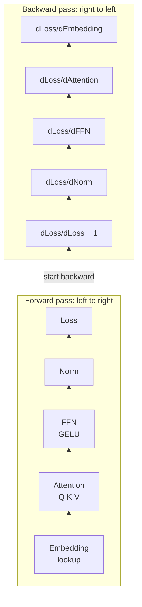

Each operation knows its local derivative (e.g., "how does my output change if my input changes?"). The **chain rule** multiplies these local derivatives together to get the gradient of the loss with respect to any weight in the network.

---

## Level 14 — The AdamW Optimizer

Gradients tell us _which direction_ to move weights. The optimizer decides _how far_ to move them.

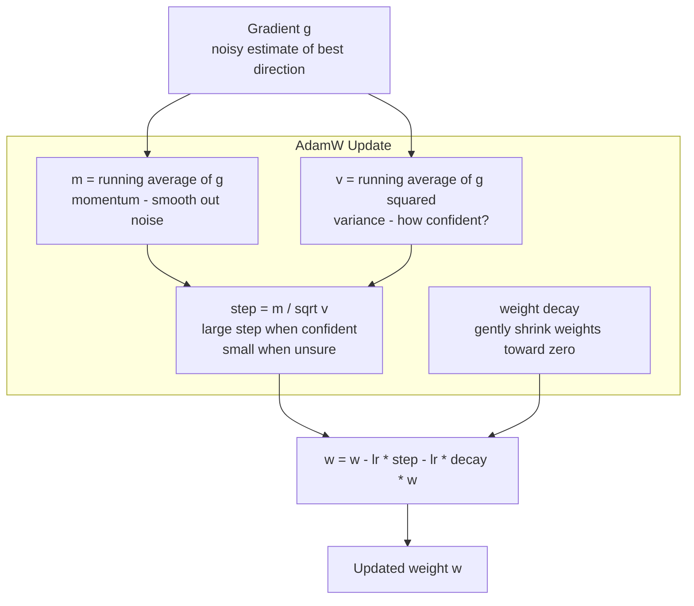

**Why not just subtract the gradient?** Raw gradients are noisy (one batch ≠ the full dataset). Adam's running averages smooth this out. The per-parameter variance scaling means frequently-updated parameters get smaller steps (already refined) while rarely-updated ones get larger steps (need more movement).

---

## Level 15 — KV Cache (Fast Inference)

During generation, we recompute the full context every time we add a token. This is O(n²) work. The KV cache eliminates redundancy.

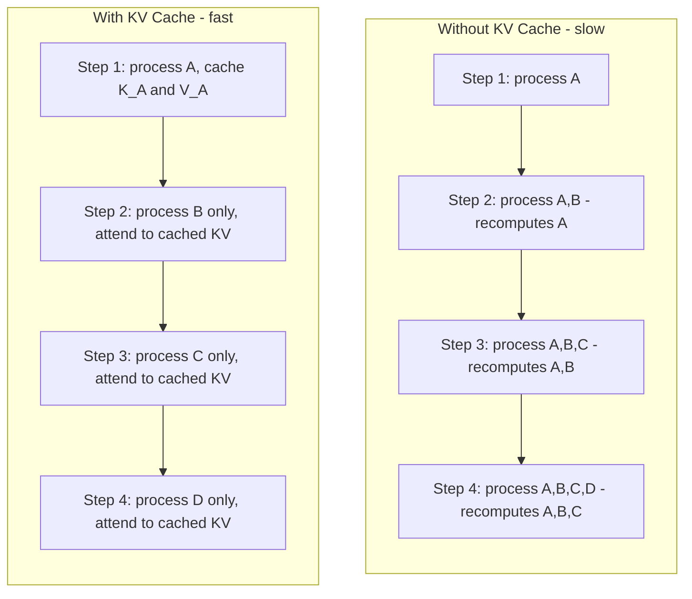

The insight: K and V vectors for past tokens never change (they only depend on that token's position and content). So we cache them and only compute Q, K, V for the new token.

> **Naming gotcha:** in systems engineering, "KV cache" usually means a generic key-value store (like Cloudflare KV or Redis). In transformer-land, "KV cache" literally means _the cache that stores K and V tensors from previous tokens_. Same name, totally different object.

### Other inference-time optimizations

These don't change the math of attention — they just change _how_ it gets computed on real hardware so it's faster, cheaper, or fits on more devices.

**Flash Attention** — reorganizes the attention computation to be cache-friendly on GPUs. Standard attention materializes the full `seq_len × seq_len` score matrix in slow GPU memory, then reads it back to multiply by V. Flash Attention tiles the work into small blocks that fit in fast on-chip SRAM, so the full score matrix is never written out. Same result, much higher throughput, much less memory traffic. It's a _systems_ optimization, not a different attention mechanism.

**KV cache quantization** — the KV cache for a long conversation can dominate memory. Storing K and V at 8-bit integers instead of 16- or 32-bit floats can shrink it 2–4×. When attention reads cached values, it dequantizes them back to full precision on the fly. You trade a tiny amount of compute for a lot of memory.

**Paged Attention** (used by vLLM, SGLang) — the KV cache for one request doesn't have to live in a single contiguous block of GPU memory. Paged Attention treats KV memory like an operating system treats virtual memory: it's split into fixed-size pages, and only the pages currently needed sit in fast memory. Unused pages can be evicted or moved. This lets a single GPU serve many concurrent requests without preallocating worst-case buffers per request, dramatically improving throughput.

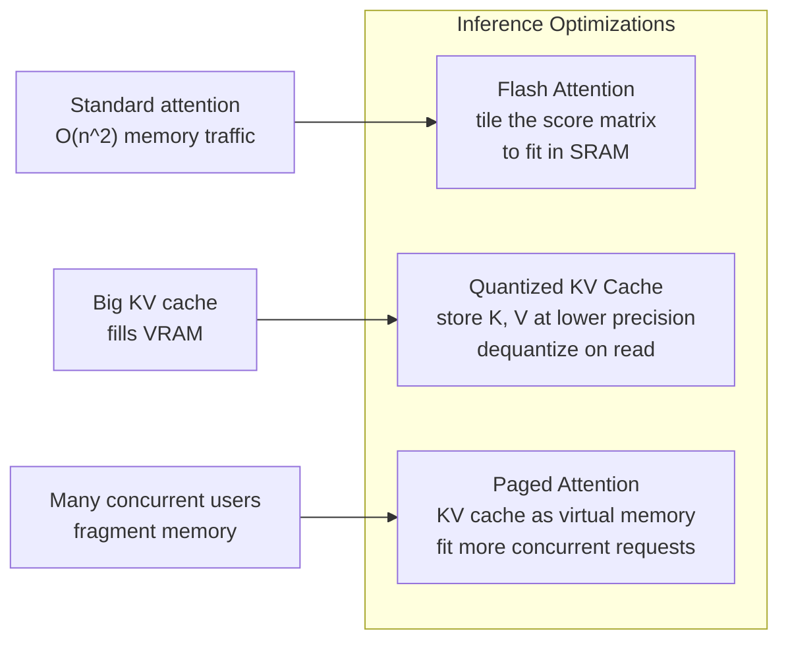

None of these are part of the trained model itself — they're properties of the _runtime_ you choose to run inference on.

---

## Level 16 — Sampling Strategies

The model outputs probabilities over the vocabulary. How we pick from that distribution controls the creativity of generation.

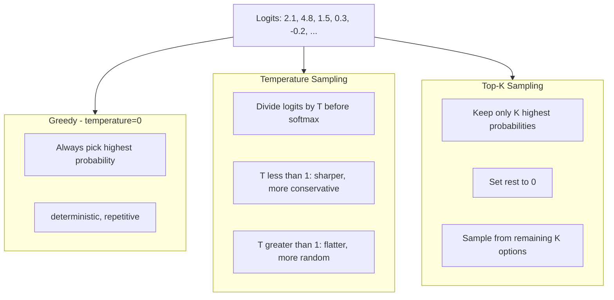

In practice, you combine temperature + top-k: scale the logits for creativity control, then restrict to top-k for safety (never pick extremely unlikely tokens).

---

## Level 17 — BPE Tokenization

Byte Pair Encoding builds a vocabulary by iteratively merging the most common adjacent pairs:

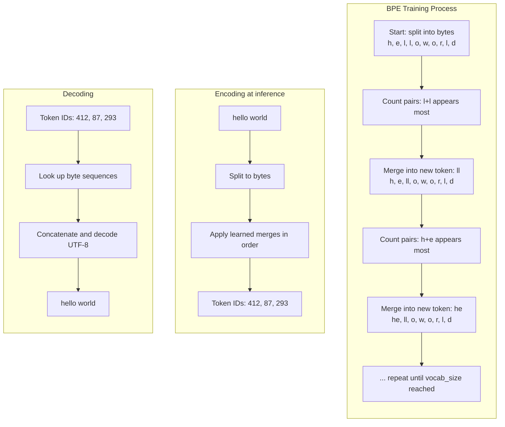

**Why BPE?** Common words become single tokens (efficient), rare words decompose into pieces (handles any input), and vocabulary size is fixed and controllable.

---

## Level 18 — Putting It All Together

The complete forward pass of a decoder-only transformer LLM:

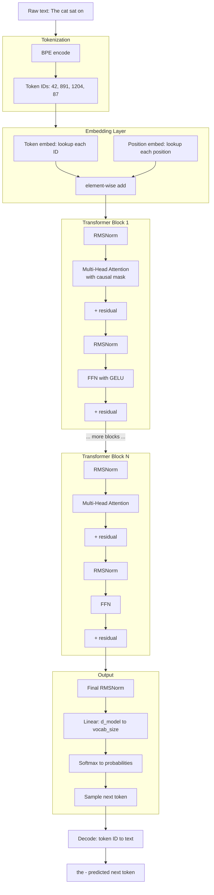

---

## Level 18b — Mechanical Trace: "Hello World" Through a Tiny Model

Let's walk through the actual mechanics with a tiny example, using the project's default-ish config:
`d_model = 256`, `n_heads = 8`, `d_k = 32`, `d_ff = 1024`, `n_layers = 4`, `vocab = 8000`.

**Input:** two tokens, `hello world`.

**Step 0 — Tokenize.** BPE turns the text into integer IDs. Say `hello → 42`, `world → 89`. Now the model sees `[42, 89]`.

**Step 1 — Embed.**

```
token_emb[42]   → 256-dim vector  E_42
token_emb[89]   → 256-dim vector  E_89
pos_emb[0]      → 256-dim vector  P_0
pos_emb[1]      → 256-dim vector  P_1

x_0 = E_42 + P_0    # "what + where" for position 0
x_1 = E_89 + P_1    # "what + where" for position 1
```

We now have a `[2, 256]` tensor flowing into Block 1.

**Step 2 — Block 1, attention sub-layer.**

For each of the 8 heads (let's pretend there's just one head for clarity, working with 32 dims):

```
Q_0 = x_0 @ W_Q      # shape: [32]
K_0 = x_0 @ W_K
V_0 = x_0 @ W_V

Q_1 = x_1 @ W_Q
K_1 = x_1 @ W_K
V_1 = x_1 @ W_V
```

Same `W_Q`, `W_K`, `W_V` matrices for both tokens — they're shared weights, not per-token. The vectors `Q_0`, `K_0`, … are temporary.

Compute scores (only valid for `query_pos ≥ key_pos` because of the causal mask):

```
score_00 = Q_0 · K_0 / sqrt(32)         # token 0 looks at token 0 only
score_10 = Q_1 · K_0 / sqrt(32)         # token 1 looks at token 0
score_11 = Q_1 · K_1 / sqrt(32)         # token 1 looks at token 1
                                        # (score_01 is masked out — future)
```

Softmax along the key axis turns these into weights:

```
position 0:  weights = softmax([score_00]) = [1.0]
position 1:  weights = softmax([score_10, score_11]) = [w0, w1]  with w0 + w1 = 1
```

Weighted sum of V's:

```
attn_out_0 = 1.0 * V_0                              # 32-dim
attn_out_1 = w0 * V_0 + w1 * V_1                    # 32-dim
```

Concatenate across the 8 heads → 256-dim per position, then multiply by `W_O` (also 256×256) to mix the heads back together.

**Step 3 — Residual + FFN.**

```
h = x + attn_out                  # residual: don't lose what we had before attention
h2 = h + FFN(RMSNorm(h))          # residual: don't lose what attention gave us
```

`FFN(z) = GELU(z @ W1) @ W2` where `W1` is `[256, 1024]` and `W2` is `[1024, 256]`. The FFN works on each position _independently_ — no mixing across tokens.

After block 1, we still have `[2, 256]` — same shape, but each vector now encodes "this token, in the context of everything before it." Position 0 is mostly itself (nothing to attend to). Position 1 is "world, having seen hello."

**Step 4 — Blocks 2, 3, 4.**

Repeat. Each block has its own separate `W_Q/W_K/W_V/W_O/W1/W2` weights. After 4 rounds, the vector at position 1 is heavily transformed — it's no longer "the embedding of 'world'", it's a rich representation of _what should come after 'hello world'_.

**Step 5 — Output head.**

Take the final-block vector at the last position, multiply by `W_out` of shape `[256, 8000]`:

```
logits = h_final[1] @ W_out       # shape: [8000]
probs  = softmax(logits)          # shape: [8000], sums to 1
```

`probs[i]` is "how likely is token `i` to come next?" Position 0 also produces logits — during training they're used to predict token `89` ("world") from "hello", so all positions contribute to the loss. During inference, you usually only care about the logits at the last position.

**Step 6 (training only) — Loss + backprop.**

Cross-entropy between predicted distribution and the true next token. Gradients flow back through every operation above, updating _every_ `W_*` matrix and the embedding tables. The Q, K, V vectors themselves get gradients too, but they're not parameters — they're just intermediate values, and their gradients are what pushes `W_Q`, `W_K`, `W_V` in the right direction.

**Step 6 (inference only) — Sample.**

Pick a token from `probs` (greedy, top-k, temperature…), append it to the sequence, and run the model again — this time with 3 tokens. KV cache means you don't recompute `K_0, V_0, K_1, V_1` — just the new ones for the new token.

That's the entire loop, all the way down.

---

## Level 19 — The Training Pipeline End-to-End

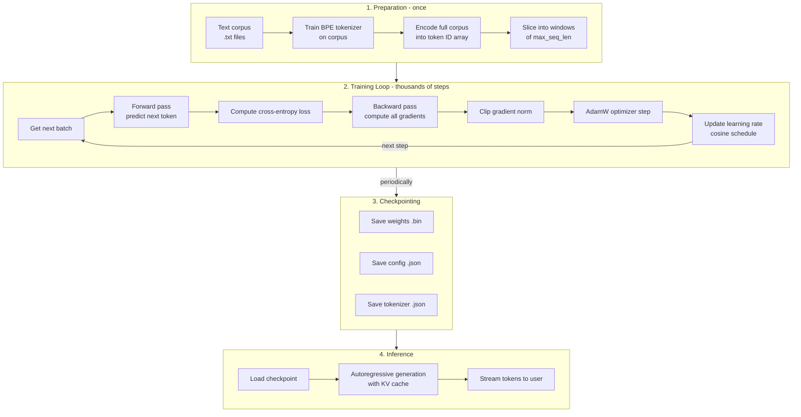

---

## Level 20 — What Makes This Work (Key Insights)

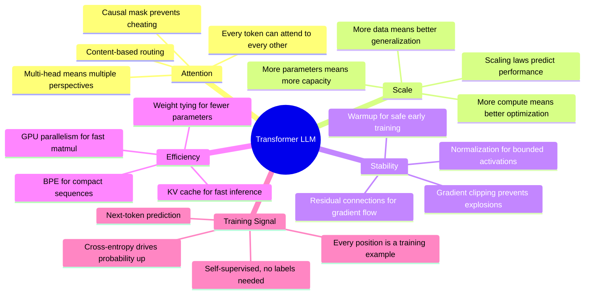

---

## Summary Table

| Layer                | Purpose                               | Key Formula                        |
| -------------------- | ------------------------------------- | ---------------------------------- |
| BPE Tokenizer        | Text → integers                       | Iterative pair merging             |
| Token Embedding      | Integer → vector                      | Lookup table: `embed[id]`          |
| Position Embedding   | Encode order                          | Lookup table: `pos[i]`             |
| RMSNorm              | Stabilize magnitudes                  | `x / sqrt(mean(x²) + ε) · γ`       |
| Multi-Head Attention | Mix information across positions      | `softmax(QKᵀ/√d + mask) · V`       |
| Feed-Forward (FFN)   | Transform each position independently | `GELU(xW₁)W₂`                      |
| Residual Connection  | Preserve information + gradient flow  | `x + sublayer(x)`                  |
| Output Head          | Vectors → vocabulary scores           | `x · W_vocab`                      |
| Cross-Entropy Loss   | Measure prediction quality            | `-log(p[correct])`                 |
| AdamW                | Intelligently update weights          | `θ -= lr · m̂/(√v̂+ε) + λθ`          |
| KV Cache             | Skip redundant computation            | Cache K, V; only compute new token |

---

## What You're Building

In this project, every single row in the table above gets implemented from scratch in TypeScript — from the WGSL GPU kernels that compute the matrix multiplications, to the autograd engine that computes gradients, to the training loop that orchestrates learning, to the inference runtime that generates text token by token.

No magic. No black boxes. Just math, running on a GPU, that you wrote.

---

## Appendix A — The Mystery That Remains

The mechanics in this document are completely understandable. Matrix multiplication, dot products, softmax, gradient descent — none of it is exotic. You can implement every line of it in TypeScript (and in this repo, you do).

The _outcome_, on the other hand, is genuinely mysterious — even to the researchers building these systems.

### Emergent capabilities

The model is only trained on one task: **predict the next token.** That's the entire supervisory signal. And yet, scaled-up models can:

- follow novel instructions like _"replace all em-dashes with commas in the following text"_, even though no training example explicitly taught that
- chain together multiple steps of reasoning
- translate between languages without translation-specific training
- write code, explain jokes, summarize papers

None of these abilities were programmed. They **emerged** from optimizing one scalar loss on enough data with enough parameters. We have no clean theory for _why_ this works — only the empirical observation that beyond certain scale thresholds, qualitatively new behaviors appear.

### The em-dash example

A small, fun illustration: many LLMs overuse em-dashes — far more than any human writer naturally would. Why? Because em-dashes are statistically over-represented in high-quality training corpora (literary classics, well-edited blog posts, polished journalism). The model learned the implicit rule _"em-dashes correlate with good writing"_ and emits them confidently, even though it has no idea they're a stylistic crutch in its own output.

That's the texture of how these models think: they pick up statistical patterns from training data, including ones the trainers never intended to teach.

### Pattern matching vs. understanding

Humans learn language from thousands of hours of multimodal, embodied experience. LLMs learn from trillions of tokens of disembodied text. Both end up doing something that _looks like_ understanding. Whether they're doing the same thing underneath — whether intelligence is just "pattern matching at sufficient scale," or whether something fundamental is missing from the LLM substrate — is an open philosophical question, not just a technical one.

You don't need to resolve that question to use these models, or to build one from scratch. But it's worth keeping in mind that **the architecture in this document is fully specified, while its emergent behavior is not.** That's the most honest summary anyone can give right now.

---

## Appendix B — Common Confusions Cheat Sheet

A distilled FAQ of the moments where intuition tends to break. Each entry is a question that genuinely confused someone learning this for the first time, with the resolution.

**Q. What does each dimension in the 256-dim embedding actually mean?**
A. We don't know, and nobody assigns meanings. Dimensions are emergent learned features. The model discovers whatever decomposition of "meaning space" makes prediction work best. Some dimensions might end up vaguely interpretable (e.g. sentiment-like) after training, but it's never guaranteed and never explicit.

**Q. Are `W_Q`, `W_K`, `W_V` the same thing as `Q`, `K`, `V`?**
A. No. `W_Q/W_K/W_V` are **persistent weight matrices** — part of the model, trained, saved, loaded. `Q/K/V` are **temporary vectors** — computed on the fly for each token in each forward pass by multiplying the embedding by those weights, used, and discarded.

**Q. Is `V` the token's embedding?**
A. No. `V` is the embedding projected through the learned `W_V` matrix. It's a transformed view of the token, shaped specifically to be useful when this token is attended to.

**Q. Why do we need `V` if `Q` and `K` already tell us where to look?**
A. `Q·K` produces _weights_ (who to attend to). `V` is the _payload_ (what to actually pass along). Different heads can learn different `W_V` matrices, so each head extracts a different aspect of an attended token.

**Q. How does attention learn what to attend to with no labels?**
A. Indirectly. Cross-entropy loss only measures next-token correctness. If a particular attention pattern correlates with better predictions, backprop reinforces the `W_Q/W_K` weights that produce it. Linguistic structure (coreference, syntax, etc.) is a _side effect_ of optimizing prediction.

**Q. After block 1, what does each vector represent?**
A. Not "the meaning of this token" anymore. It's "the meaning of this token _in the context of everything before it_." After 4 blocks, it's "this token in context, refined through 4 rounds of context-gathering and processing."

**Q. Are blocks 1, 2, 3, 4 the same weights?**
A. No. Each block has its own independent `W_Q/W_K/W_V/W_O/W1/W2`. Stacking the same weights wouldn't add capacity — it'd just apply the same function repeatedly.

**Q. What does "KV cache" mean here vs. in systems engineering?**
A. In systems, "KV cache" usually means a generic key-value store. In transformers, "KV cache" means specifically _the cache that stores K and V tensors from previous tokens_ so they don't get recomputed each generation step. Same name, very different object.

**Q. What's a tensor vs. a vector vs. a matrix?**
A. A tensor is the general term for any n-dimensional array of numbers. A vector is a 1D tensor, a matrix is a 2D tensor, a stack of matrices is a 3D tensor, a batch of those is 4D, and so on. Deep-learning frameworks just say "tensor" for everything.

**Q. If I trained the model on 1024-token sequences, can I run inference at 4096 tokens?**
A. You can, but quality degrades. The model never saw relationships across 4096 positions during training, and position embeddings beyond position 1024 are either undefined or extrapolated. Some position-encoding schemes (RoPE, ALiBi) extrapolate gracefully; others fall apart quickly. The "native context window" in a model card refers to the training sequence length.

**Q. Does the model "remember" something from sequence A when it processes sequence B during training?**
A. Only via the weight updates. Each training sequence is processed independently — no hidden state carries over. But every backprop step nudges the weights, so sequence B is processed by _slightly improved_ weights compared to sequence A. Learning is cumulative through weights, not through context.

**Q. Why do we expand to `d_ff = 4 × d_model` in the FFN and then come back?**
A. The expansion plus GELU gives the model "more room to think" nonlinearly. A pure 256→256 transform is just a linear map and would have limited expressivity. Expanding to 1024, applying GELU, and contracting back lets the model learn richer per-token transformations. The 4× ratio is empirical — researchers found it's a sweet spot of capacity vs. cost.

**Q. Why is the loss capped near `ln(vocab_size)`?**
A. Cross-entropy loss is `-log(p_correct)`. The worst possible useful prediction is uniform probability over the vocab — `p = 1/vocab_size`. That gives `loss = ln(vocab_size)`. For vocab 8000, that's about 8.99. A loss of 6.8 means the model is already significantly better than uniform.
